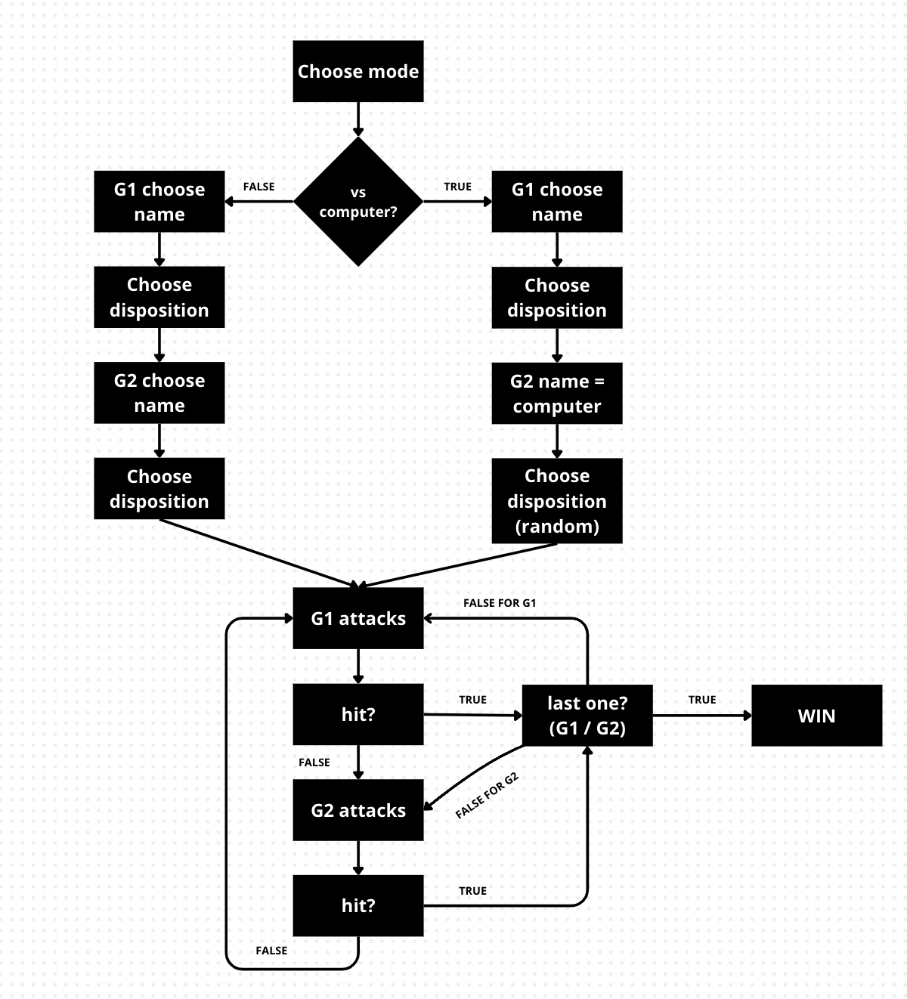

# Battleship in Java

[](https://github.com/simo-macca/battleship/actions/workflows/lab.yml)


A desktop version of the classic Battleship game, written in Java 17 with the
[JTamaro](https://github.com/LuCEresearchlab/jtamaro) functional graphics library.
You place your fleet by drag and drop, then play against a friend on the same computer or against the computer at one of two difficulty levels.

## Features

- **Two game modes:** local 2-player (pass-and-play) or player vs. computer.
- **Two AI difficulty levels:**
  - **Easy:** fires at random cells it hasn't attacked yet.
  - **Hard:** uses a *hunt-and-target* strategy. After a hit it tries the neighbouring cells (up, down, left, right) until the ship sinks.
- **Drag-and-drop fleet placement**, with ship rotation.
- **Immutable game state:** each input event returns a new `Game` record instead of changing the old one.

## Gameplay

The game uses a 10×10 grid. Each player places four ships before combat starts:

| Ship             | Size (tiles) | Colour  |
| :--------------- | :----------: | :------ |
| Destroyer        | 2            | Green   |
| Submarine        | 3            | Blue    |
| Battleship       | 4            | Magenta |
| Aircraft Carrier | 5            | Orange  |

Players take turns firing a single bomb at the opponent's grid. The first player to sink the whole enemy fleet wins.

## Controls

### Global (any phase)

| Key | Action                          |
| :-: | :------------------------------ |
| `R` | Restart from the main menu      |
| `Q` | Quit the application            |

### By phase

| Phase                | Input                  | Action                                               |
| :------------------- | :--------------------- | :--------------------------------------------------- |
| Mode selection       | `U`                    | User vs. User                                        |
|                      | `C`                    | User vs. Computer                                    |
| Difficulty selection | `E`                    | Easy (random AI)                                     |
|                      | `H`                    | Hard (hunt-and-target AI)                            |
| Fleet placement      | Mouse drag & drop      | Move a ship onto the grid                            |
|                      | `S`                    | Rotate the selected ship (horizontal / vertical)     |
|                      | `N`                    | Confirm the fleet and continue                       |
| Weapon selection     | `S`                    | Select the bomb and start aiming (human player)      |
|                      | `Enter`                | Let the computer play its turn                       |
| Targeting            | Mouse click            | Fire at a cell on the opponent's grid                |
| After attack         | `N`                    | Confirm the result and pass the turn                 |

## Getting started

### Prerequisites

- **JDK 17.** The build uses a Gradle Java toolchain pinned to version 17, so a JDK 17 must be installed. Gradle runs on a newer JDK too, but it won't download JDK 17 for you.
- **Gradle** is not required. The repository includes the Gradle wrapper (`gradlew`).

### Run

```bash
git clone https://github.com/simo-macca/battleship.git
cd battleship
./gradlew run
```

On Windows:

```powershell
.\gradlew.bat run
```

### Run from an IDE

Open the project folder in IntelliJ IDEA, VS Code or Eclipse as a Gradle project, then run `project.Main`.
Gradle loads JTamaro from the local `deps/` repository and everything else from Maven Central.

### Build a distribution

```bash
./gradlew assemble
```

This creates runnable `.zip` and `.tar` archives (with launch scripts) in `build/distributions/`.

## Testing and code quality

| Command                       | What it does                                                    | Report                          |
| :---------------------------- | :-------------------------------------------------------------- | :------------------------------ |
| `./gradlew test`              | Runs the JUnit 4 test suite (game phases, players, boats, AI)   | `build/reports/tests/test/`     |
| `./gradlew jacocoTestReport`  | Generates JaCoCo test-coverage reports                          | `build/jacoco/html/index.html`  |
| `./gradlew pmdMain pmdTest`   | Runs PMD 7 static analysis using the rules in `pmd.xml`         | `build/reports/pmd/`            |
| `./gradlew cpdCheck`          | Runs copy-paste (duplicate code) detection                      | `build/reports/cpd/`            |
| `./gradlew check`             | Runs the tests and every check above in one go                  |                                 |

Code formatting runs as a [pre-commit](https://pre-commit.com/) hook (`pretty-format-java`). To enable it:

```bash
pip install pre-commit
pre-commit install
```

## Architecture

The code is split into a **model** layer (game rules and state) and a **UI** layer (rendering with JTamaro).
`Main` connects them through JTamaro's `IO.interact`. Every keyboard or mouse event is passed to the current `Game`, which returns a new `Game`.

- **`project.model`:** game state (`Game`), positions, boats, players, AI, weapons and phases.
- **`project.ui`:** draws the boards, boats, projectiles and the screen for each phase.
- **`project.configuration`:** constants such as board position, tile size, window size and default players.
- **`project.Toolbelt`:** small helpers for immutable sequences and basic shapes.

### Design patterns

**State pattern: game phases.** Each screen of the game is a separate `Phase` implementation. The phase decides how to handle input and what to render:



| Phase               | Purpose                                                           |
| :------------------ | :---------------------------------------------------------------- |
| `Mode`              | Main menu: choose 2-player or vs. computer                        |
| `ChooseDifficulty`  | Choose Easy or Hard AI                                            |
| `PlayerSetting`     | Place and rotate ships                                            |
| `ChooseWeapon`      | Select the weapon before aiming                                   |
| `ChoosePosition`    | Click a cell on the opponent's grid to fire                       |
| `AfterAttack`       | Show hits, misses and sunk ships before the turn passes           |
| `RoundEnded`        | Announce the winner                                               |

**Polymorphic players.** `Human`, `RandomComputer` and `LogicComputer` all implement `Player`, so a phase handles a turn the same way no matter who is playing. The hunt-and-target AI uses the `Direction` implementations (`Up`, `Down`, `Left`, `Right`) to pick the next cell to try.

**Visitor pattern: projectiles.** `HitProjectile` and `MissProjectile` accept a `ProjectileVisitor`. `ProjectileRenderer` uses it to draw each projectile type without `instanceof` checks.

The full UML model diagram is in [`extra/model.png`](extra/model.png).

## Project structure

```text
battleship/
├── build.gradle / settings.gradle   # Gradle build and repository configuration
├── gradlew, gradlew.bat, gradle/    # Gradle wrapper
├── pmd.xml                          # PMD rule set
├── .pre-commit-config.yaml          # Formatting and hygiene hooks
├── deps/                            # Local Maven repository (JTamaro 24.0.3, CPD plugin)
├── extra/                           # Diagrams and design sketches
├── .github/workflows/lab.yml        # CI: build, test and static analysis
└── src/
    ├── main/java/project/
    │   ├── Main.java                # Entry point; connects input handlers to the game
    │   ├── Toolbelt.java            # Sequence and shape helpers
    │   ├── configuration/           # Game constants and defaults
    │   ├── model/
    │   │   ├── Game.java            # Immutable game state
    │   │   ├── Position.java        # Grid coordinates
    │   │   ├── boat/                # Boats and hit tracking
    │   │   ├── phase/               # State-pattern phases
    │   │   ├── players/             # Human and computer players
    │   │   │   └── directions/      # Search directions for the hard AI
    │   │   └── weapon/              # Weapons and projectiles
    │   └── ui/
    │       ├── GameUI.java          # Shared rendering components
    │       ├── board/               # Board drawing and screen-to-grid conversion
    │       ├── boat/                # Boat graphics and drag state
    │       ├── cartesianWorldGraphics/  # Cartesian coordinate helpers
    │       ├── phase/               # Rendering for each phase
    │       └── visitor/             # Projectile visitor and renderer
    └── test/java/project/model/     # JUnit 4 tests
```

## Authors

- [Alessandra Sasanelli](https://github.com/Alessandra-Sasanelli)
- [Simone Maccario](https://github.com/SimoneMaccario)

## Acknowledgements

Built with [JTamaro](https://github.com/LuCEresearchlab/jtamaro), a functional graphics and interaction library for Java developed by the LuCE Research Lab.
